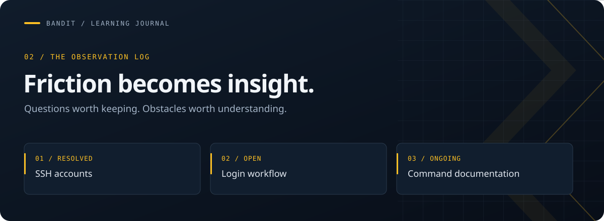

**[The journey](README.md) &nbsp; / &nbsp; [Learning journal](FRICTIONS.md) &nbsp; / &nbsp; [Development goals](GOALS.md)**

# Learning Frictions

---

A record of the questions, interruptions, and documentation gaps I encounter while learning Linux. Each entry explains the experience, why it affected my progress, and what I understand now. The goal is to turn frustration into useful notes I can revisit as my skills develop.

> **🧭 How to read this journal**
>
> 🟢 **Resolved** — a concept that is now clear.
> 🟠 **Open question** — a design decision I want to understand.
> 🔵 **Ongoing** — a recurring difficulty I am working through.

## Browse the journal

*Three observations from learning Linux, organized by the question behind each one.*

| Entry | Topic | Area | Status |
| --- | --- | --- | --- |
| [001 · Understanding SSH accounts](#001--understanding-ssh-accounts) | Which account belongs to each level? | SSH & Linux users | 🟢 Resolved |
| [002 · Repeated SSH logins](#002--repeated-ssh-logins) | How reconnecting affects learning momentum | Learning workflow | 🟠 Open question |
| [003 · Finding practical command examples](#003--finding-practical-command-examples) | Moving from reference documentation to practical use | Documentation & command discovery | 🔵 Ongoing |

---

**🟢 RESOLVED · SSH & LINUX USERS**

## 001 · Understanding SSH accounts

*One server. Different accounts. A clearer picture of how the levels connect.*

| Context | Category | Status |
| --- | --- | --- |
| Level 1 → Level 2 | SSH / Linux user accounts | Resolved |

### The experience

When I first moved between Bandit levels, I was unsure which machine or account I needed to connect to next. I initially understood each level as a separate server, which made the transition confusing: after finding the next password, I still needed to work out where it belonged and which username to use.

### What became clear

The levels use the same SSH server, with a different Linux user account for each level. Moving forward means authenticating as the next user on that server. The account I use corresponds to the level I am currently solving, and the password I find grants access to the next account.

| Challenge | Current SSH account | Goal |
| --- | --- | --- |
| Level 0 → Level 1 | `bandit0` | Find the password for `bandit1` |
| Level 1 → Level 2 | `bandit1` | Find the password for `bandit2` |
| Level 2 → Level 3 | `bandit2` | Find the password for `bandit3` |

### Practical reference

These commands helped me understand the transition and check which account I was using:

| Command | Purpose |
| --- | --- |
| `whoami` | Verify the current Linux account |
| `exit` | Close the current SSH session |
| `ssh bandit2@bandit.labs.overthewire.org -p 2220` | Connect to the Bandit server as `bandit2` |

> **💡 Lesson retained**
>
> For Level X → Level Y, connect as `banditX` and find the password for `banditY`.

[↑ Back to journal index](#browse-the-journal)

---

**🟠 OPEN QUESTION · LEARNING WORKFLOW**

## 002 · Repeated SSH logins

*The concept makes sense. The repeated transition still interrupts the flow.*

| Context | Category | Status |
| --- | --- | --- |
| Moving between Bandit levels | SSH / Learning workflow | Open question |

### The experience

Repeatedly closing an SSH session and authenticating with a different account feels repetitive. After completing a lesson, I want to continue exploring the next concept, but the login transition adds another step before I can resume. Over several lessons, this interrupts my learning momentum and makes the workflow feel less continuous than I would prefer.

### What I understand so far

The levels already run on the same server. The repetition comes from switching Linux user accounts, rather than moving to a new device or node. Understanding that distinction resolved my initial confusion about the environment, but it did not remove the friction of reconnecting between lessons.

### The experience I would prefer

I would prefer to progress through lessons within one continuous session, with a clear transition into the next exercise. That would let me spend more attention on the Linux concepts and less on repeating the connection process.

> **🔎 Question to revisit**
>
> Why does each level require a separate user account and SSH login? What learning or access-control benefits does this structure provide compared with completing the lessons under one account in a continuous session?

[↑ Back to journal index](#browse-the-journal)

---

**🔵 ONGOING · DOCUMENTATION & DISCOVERY**

## 003 · Finding practical command examples

*Finding an option is only half the task. Understanding how to use it comes next.*

| Context | Category | Status |
| --- | --- | --- |
| Levels 8 → 9 and 9 → 10 | Linux documentation / Command discovery | Ongoing |

### The experience

Searching manual pages is not always straightforward when I am learning an unfamiliar command. I may understand the task I want to accomplish without knowing the terminology used in the documentation. This makes it difficult to choose a useful search term, locate the relevant option, and determine whether it solves my problem.

The `uniq` manual page I consulted did not include practical usage examples. Although it described the available options, I still had to work out how to assemble them into a complete command. Reading syntax and understanding how to apply it are separate steps, and the gap between them can slow down a beginner considerably.

### Why this matters to my learning

I want to become comfortable finding answers directly in the terminal. Documentation is central to that goal, but it is harder to learn independently when a reference assumes familiarity with the command or provides little context for its use. A complete example would help me connect the description of an option with a concrete task and a result I can verify.

### What better documentation would look like

In 2026, I would expect terminal documentation to offer clearer explanations, more detailed guidance, and easier ways to search or navigate interactively. I would like every manual page to include a consistent examples section with complete commands and a plain-language explanation of what each command does. The command-and-explanation format I have seen in `kubectl` help is the kind of approach I find useful.

Examples should cover common tasks, explain the options used, and show expected results where practical. A reader should be able to understand the purpose of an example, try it with practice data, and recognize whether it worked. This would make documentation more approachable while retaining the detail needed for deeper reference.

> **🔎 Question to revisit**
>
> How can Linux documentation preserve its technical detail while making practical examples and relevant information easier for new users to find?

[↑ Back to journal index](#browse-the-journal)

---

## ✍️ Keeping the journal useful

New entries will follow the same structure: context and status, a description of the experience, what I understand so far, and a lesson or question to revisit. Existing entries can be updated as a concept becomes clearer or a recurring difficulty is resolved.

This journal records my learning process without publishing passwords, credentials, or challenge spoilers.
