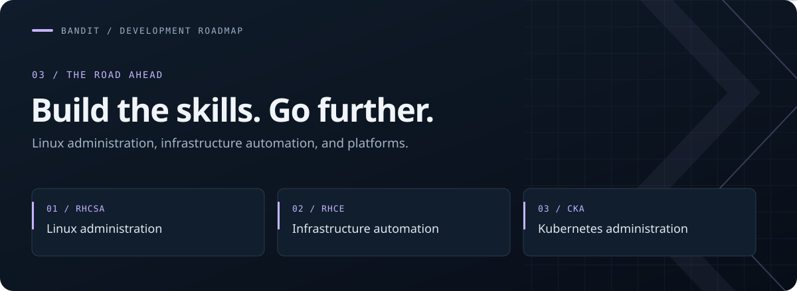

**[The journey](README.md) &nbsp; / &nbsp; [Learning journal](FRICTIONS.md) &nbsp; / &nbsp; [Development goals](GOALS.md)**

# Professional Development Goals

> **The direction**
>
> Become proficient in Linux systems administration, infrastructure automation, and platform engineering through sustained, practical work.

I'm using OverTheWire Bandit to strengthen my Linux fundamentals as part of this long-term goal. My certification roadmap includes RHCSA, RHCE, and CKA, supported by hands-on labs and practical infrastructure projects.

---

## The roadmap

### 01 / Linux systems administration

**Certification goal · RHCSA**

Build a strong foundation in administering Linux systems. Bandit is part of that foundation: navigating filesystems, understanding permissions, working with text, and learning to investigate unfamiliar problems from the command line.

> **Practice focus:** Develop confidence with the fundamentals through repeatable, hands-on exercises.

### 02 / Infrastructure automation

**Certification goal · RHCE**

Build on Linux administration skills by learning to automate infrastructure tasks. Support certification preparation with labs and practical projects that connect individual commands to repeatable operational workflows.

> **Practice focus:** Turn tasks I understand into processes I can repeat and maintain.

### 03 / Platform engineering

**Certification goal · CKA**

Develop Kubernetes administration skills as part of a broader platform engineering direction. Pair certification study with hands-on work that connects Linux knowledge, infrastructure automation, and operating containerized workloads.

> **Practice focus:** Apply the foundations to practical infrastructure and platform projects.

---

## From study to practice

| Learn | Apply | Document |
| --- | --- | --- |
| Build understanding through study and command documentation | Reinforce concepts in hands-on labs and infrastructure projects | Record useful lessons, questions, and obstacles |

These certifications are development goals. My aim is to build practical ability alongside the credentials and keep a clear record of what I learn.

## Where the work lives

**[Level notes →](levels/)** Explore the Linux concepts I am practicing in Bandit.

**[Learning journal →](FRICTIONS.md)** Follow the questions and obstacles that shape my learning.

---

[← Back to my learning journey](README.md)
