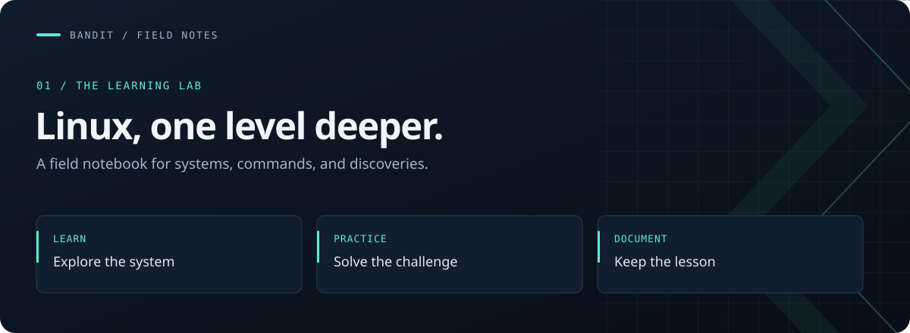
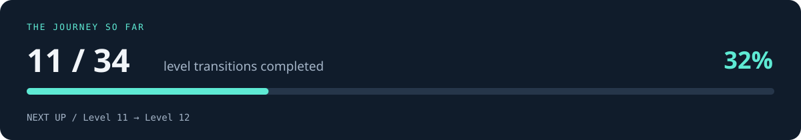
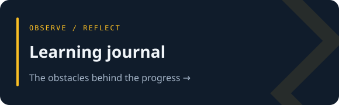
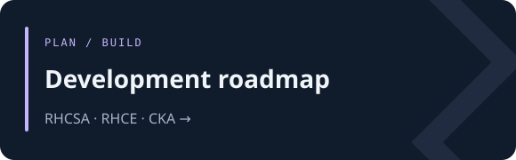

**[Featured lessons](#featured-lessons) &nbsp; / &nbsp; [Progress](#progress) &nbsp; / &nbsp; [Journal](FRICTIONS.md) &nbsp; / &nbsp; [Goals](GOALS.md)**

# My Linux Learning Portfolio

I'm learning Linux by working through **OverTheWire Bandit**, investigating unfamiliar tools, and documenting what I discover. This is my working notebook for a longer journey into **systems administration, infrastructure automation, and platform engineering**.

## Progress

<strong>Explore the full level checklist · 11 completed / 23 remaining</strong>

### Foundations· Levels 0–11

- [x] Level 0 → Level 1
- [x] Level 1 → Level 2
- [x] Level 2 → Level 3
- [x] Level 3 → Level 4
- [x] Level 4 → Level 5
- [x] Level 5 → Level 6
- [x] Level 6 → Level 7
- [x] Level 7 → Level 8
- [x] Level 8 → Level 9
- [x] Level 9 → Level 10
- [x] Level 10 → Level 11

### Building depth · Levels 11–22

- [ ] Level 11 → Level 12
- [ ] Level 12 → Level 13
- [ ] Level 13 → Level 14
- [ ] Level 14 → Level 15
- [ ] Level 15 → Level 16
- [ ] Level 16 → Level 17
- [ ] Level 17 → Level 18
- [ ] Level 18 → Level 19
- [ ] Level 19 → Level 20
- [ ] Level 20 → Level 21
- [ ] Level 21 → Level 22

### Further challenges · Levels 22–34

- [ ] Level 22 → Level 23
- [ ] Level 23 → Level 24
- [ ] Level 24 → Level 25
- [ ] Level 25 → Level 26
- [ ] Level 26 → Level 27
- [ ] Level 27 → Level 28
- [ ] Level 28 → Level 29
- [ ] Level 29 → Level 30
- [ ] Level 30 → Level 31
- [ ] Level 31 → Level 32
- [ ] Level 32 → Level 33
- [ ] Level 33 → Level 34

## Featured lessons

*A few discoveries that changed how I approach the terminal.*

<table>
<tr>
<td width="50%" valign="top">

**01 / SEARCH WITH INTENT**

### Find the file, wherever it lives

Combine ownership, group, and size filters. Understand permission errors and keep useful output visible with stream redirection.

`find` · `stderr` · `/dev/null`

[Read Level 6 → Level 7 →](levels/07-level-06-to-07/README.md)

</td>
<td width="50%" valign="top">

**02 / MAKE TEXT WORK FOR YOU**

### Turn repeated lines into an answer

Group identical lines, count occurrences, and discover how small commands work together through pipes.

`sort` · `uniq` · pipes

[Read Level 8 → Level 9 →](levels/09-level-08-to-09/README.md)

</td>
</tr>
<tr>
<td width="50%" valign="top">

**03 / INVESTIGATE THE UNFAMILIAR**

### Discover text inside binary data

Identify a file, extract printable strings, and filter the results. Learn how to discover a tool before knowing its name.

`file` · `strings` · `apropos`

[Read Level 9 → Level 10 →](levels/10-level-09-to-10/README.md)

</td>
<td width="50%" valign="top">

**04 / UNDERSTAND THE REPRESENTATION**

### Decode data with confidence

Explore Base64, read command syntax, and understand where input comes from. Encoding changes representation; it does not provide confidentiality.

`base64` · `stdin` · manual pages

[Read Level 10 → Level 11 →](levels/11-level-10-to-11/README.md)

</td>
</tr>
</table>

**[Browse all level notes →](levels/)**

## Behind the progress

The **[learning journal](FRICTIONS.md)** records the questions and interruptions that don't fit neatly into a completed level. The **[development roadmap](GOALS.md)** connects this daily practice to my certification goals and future infrastructure projects.

## Skills I'm building

| Area | Focus |
| --- | --- |
| 🐧 Linux fundamentals | Command-line navigation, files, and directories |
| 🔑 Access & permissions | SSH, user accounts, ownership, and file permissions |
| 🔎 Text & data | Searching, filtering, sorting, pipes, and encoding |
| 🌐 Networking | Network concepts and command-line tools |
| ⚙️ Automation | Bash scripting and combining Linux utilities |
| 🌱 Version control | Git, GitHub, and documenting changes |

## How I learn

> **Understand → Discover → Read → Test → Verify**
>
> Start with the problem. Find a relevant tool. Read its documentation. Try it with purpose. Check that the result meets the requirement.

Each level writeup captures the concepts I explored, commands I practiced, and lessons I want to retain. My goal is to build practical understanding alongside my **RHCSA, RHCE, and CKA** roadmap, supported by hands-on labs and infrastructure projects.

<strong>About these writeups</strong>

This repository documents my learning process. Passwords, private keys, and other level credentials are excluded. Completion markers reflect my progress checklist; individual writeups provide further context on what I practiced.

Challenges are provided by [OverTheWire Bandit](https://overthewire.org/wargames/bandit/).

---

**Built through practice, one level at a time.**

[Start with Bandit](https://overthewire.org/wargames/bandit/) · [Explore my notes](levels/) · [Follow the roadmap](GOALS.md)

